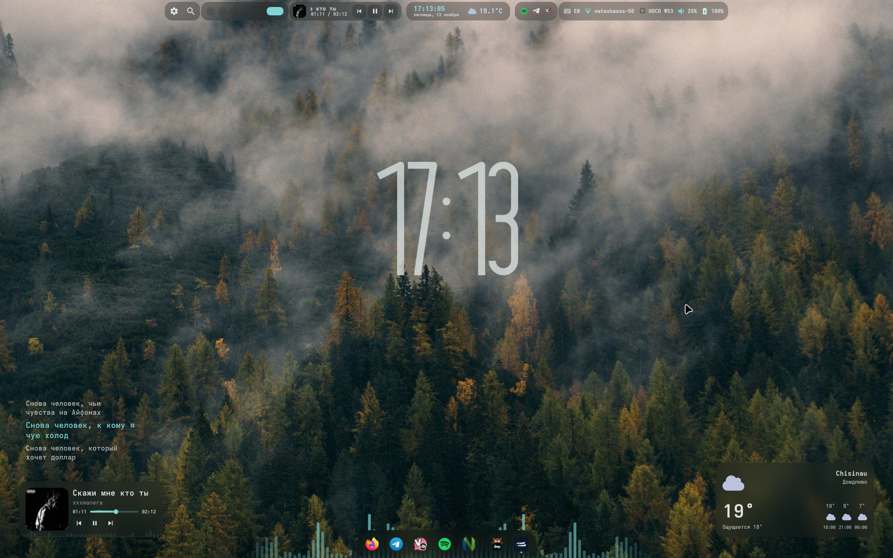
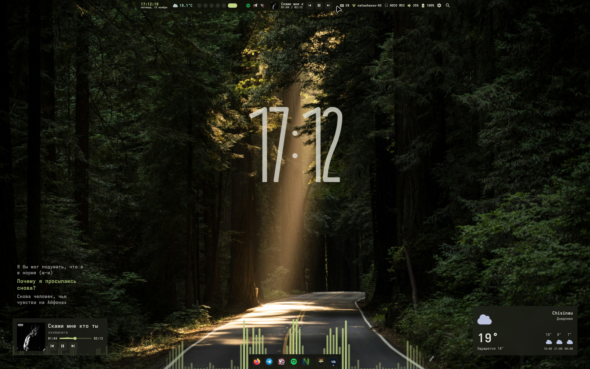
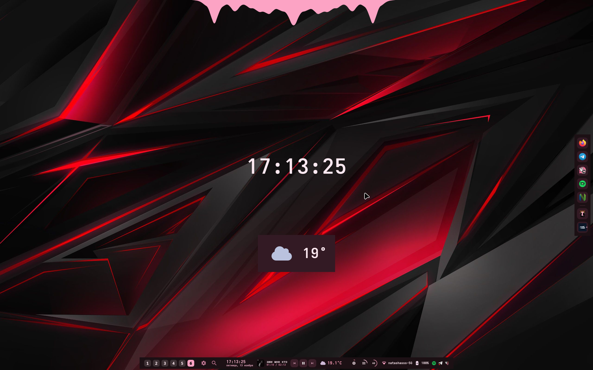

# my-config

Мои личные конфиги для Arch Linux + универсальный скрипт установки и обслуживания системы.

Репозиторий самодостаточный: один скрипт можно перекинуть на чистую систему, и он сам скачает
все конфиги из этого репозитория и настроит окружение.

---

## Быстрый старт

Скачать и запустить интерактивное меню:

```bash
curl -fsSL https://raw.githubusercontent.com/stylishlasher/my-config/main/install/install.sh | bash
```

Полная установка без меню (AUR-хелпер → dotfiles → fish → neovim/neovide → mpv → GSR → архивы → Flatpak → LibreWolf → файрвол → темы):

```bash
curl -fsSL https://raw.githubusercontent.com/stylishlasher/my-config/main/install/install.sh | bash -s -- -f
```

Только аудит и оценка системы:

```bash
curl -fsSL https://raw.githubusercontent.com/stylishlasher/my-config/main/install/install.sh | bash -s -- -a
```

> Требуется Arch Linux или производный дистрибутив (нужен `pacman`).
> Запускать от обычного пользователя — `sudo` запрашивается по необходимости.

---

## ⚠️ ПРЕСЕТЫ НУЖНО ВКЛЮЧИТЬ ВРУЧНУЮ

> [!IMPORTANT]
> Скрипт **только копирует** файлы-пресеты из репозитория (все `*.json` в корне,
> например `glass.json`, `archy-style.json`, `ultra-minimalist.json`) в
> `~/.local/state/serpantinum/presets`. Чтобы тема применилась, её надо **выбрать вручную**:
>
> **Serpantinum → Настройки → Presets (Пресеты) → выбрать нужную тему.**
>
> Без этого шага цвета/оформление не изменятся.

---

## ⚠️ ДРАЙВЕРЫ GPU НЕ УСТАНАВЛИВАЮТСЯ АВТОМАТИЧЕСКИ

> [!WARNING]
> Скрипт **не ставит** драйверы видеокарты. Установите их под свою GPU **до перезагрузки**,
> иначе Hyprland / Serpantinum могут не запуститься:
>
> ```bash
> # NVIDIA
> sudo pacman -S nvidia nvidia-utils nvidia-settings
> # AMD
> sudo pacman -S mesa vulkan-radeon libva-mesa-driver
> # Intel
> sudo pacman -S mesa vulkan-intel intel-media-driver
> ```

---

## Скриншоты пресетов

| Пресет | Вид |
|---|---|
| `glass` |  |
| `archy-style` |  |
| `ultra-minimalist` |  |

---

## Что это за скрипт

**Arch Multitool** (`arch_multitool.sh`) — универсальный инструмент для чистой установки,
настройки и обслуживания Arch Linux. Умеет всё в одном меню:

**Установка и настройка:**
- полная установка окружения одной командой;
- AUR-хелпер (`yay` / `paru`);
- dotfiles (окружение **Serpantinum**, см. раздел «Благодарности»);
- раскладка клавиатуры `us,ru` в Hyprland (автопатч `settings.lua`);
- `fish` + плагины (`fisher`, `tide`) с применением конфига;
- `neovim` + `neovide` с применением конфига и Nerd Font;
- `mpv` (медиаплеер) — ставится автоматически;
- **GPU Screen Recorder** (`gpu-screen-recorder` + UI-оверлей);
- утилиты для архивов: **PeaZip** (GUI) и консольные (`tar`, `zip`, `unzip`, `unrar`, `7zip`, ...);
- **файрвол** — автонастройка `ufw` или `firewalld` (с объяснением разницы);
- применение личных конфигов и тем Serpantinum (`glass`, `archy-style`, `ultra-minimalist` — авто-поиск всех пресетов);
- `flatpak` + репозиторий Flathub (автонастройка) и **Sober** (Roblox на Linux) по выбору;
- **FreeSM Launcher** (Minecraft, AUR) по выбору;
- основной набор ПО с выбором галочками; браузер: Firefox / Chromium / **LibreWolf**;
  клиент Discord: Discord / Vencord; **steam** — по желанию (по умолчанию выключен).

**Обслуживание системы (без установки):**
- аудит и оценка системы (отчёт в файл);
- полное обновление (`pacman` + AUR);
- оптимизация и очистка (сироты, кэш, журнал, кэш AUR, Flatpak);
- бэкап конфигураций в `.tar.zst`;
- ремонт ключей `pacman`;
- обновление зеркал через `reflector`;
- утилиты Hyprland / Wayland / Audio / Serpantinum.

Каждый компонент можно поставить отдельно — все пункты установки доступны и поодиночке.

### Как это работает

- Если конфиги (`fish/`, `nvim/`, `*.json`) лежат рядом со скриптом — берутся они.
- Иначе скрипт **скачивает архив** этого репозитория и применяет конфиги оттуда.
- Старые конфиги не удаляются, а сохраняются с суффиксом `.bak.<дата>`.
- Жёсткие пути `/home/<старый-пользователь>` в конфигах автоматически заменяются на `$HOME`.
- Необязательный файл настроек: `~/.config/arch_multitool.conf`.

---

## Структура репозитория

```
my-config/
├── arch_multitool.sh      # сам мультитул
├── install/
│   └── install.sh         # установщик-загрузчик (curl | bash)
├── install.txt            # команда установки Serpantinum (читается мультитулом)
├── fish/                  # конфиг fish (config.fish, conf.d, functions, ...)
├── nvim/                  # конфиг Neovim (init.lua)
├── placeholders/          # скриншоты пресетов для README
├── glass.json             # тема Serpantinum «стекло»
├── archy-style.json       # тема Serpantinum «минимализм»
└── ultra-minimalist.json  # тема Serpantinum «ультра-минимализм»
```

> Пресеты определяются автоматически: функция `apply_archy_themes` находит **все**
> `*.json` в корне репозитория и копирует их в presets.
> Новые темы из репозитория подхватываются сами при нажатии пункта 7 меню.

Куда применяются конфиги:

| Что | Куда |
|---|---|
| fish | `~/.config/fish/` |
| neovim | `~/.config/nvim/init.lua` |
| neovide | `~/.config/neovide/` (если есть) |
| раскладка клавиатуры | `~/.config/hypr/config/settings.lua` (`kb_layout = "us,ru"`) |
| пресеты Serpantinum | `~/.local/state/serpantinum/presets/` |

> [!WARNING]
> После копирования пресетов **обязательно** включите нужный в
> **Serpantinum → Настройки → Presets (Пресеты) → выбрать тему**. Само по себе
> копирование файлов внешний вид не меняет.

---

## Благодарности

Основное рабочее окружение (Wayland-шелл, панель, темы, аудио и т.д.) — это проект
**Serpantinum**, а не моя разработка. Спасибо автору и контрибьюторам:

- **Автор:** Illia Miroshnichenko ([@ilyamiro](https://github.com/ilyamiro))
- **Репозиторий:** https://github.com/ilyamiro/serpantinum
- **Сайт и документация:** https://serpantinum.dev
- **Лицензия:** GNU AGPL-3.0

Установка самого Serpantinum (используется мультитулом в пункте про dotfiles):

```bash
curl -fsSL install.serpantinum.dev | bash
```

Темы `glass.json`, `archy-style.json` и `ultra-minimalist.json` — это пресеты оформления Serpantinum.

---

## Лицензия

Скрипты и личные конфиги в этом репозитории распространяются под лицензией MIT
(см. [LICENSE](LICENSE)). Проект Serpantinum лицензирован отдельно (AGPL-3.0).
